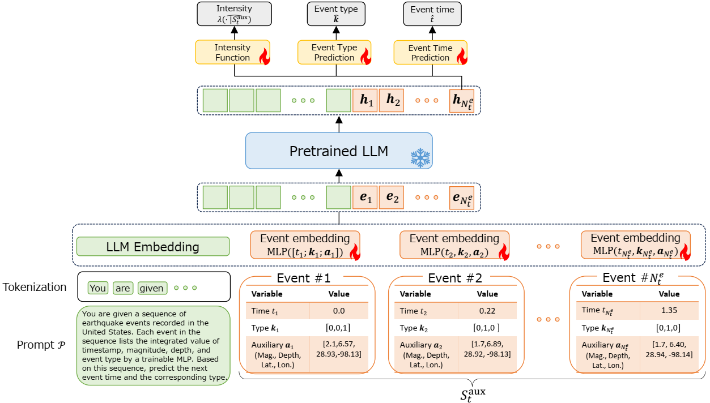

# LLM-AeMPP

**LLM-AeMPP** is an extended implementation of [TPP-LLM](https://arxiv.org/abs/2410.02062), a framework that integrates Temporal Point Processes (TPPs) with Large Language Models (LLMs) for event sequence modeling and prediction.

This project investigates how continuous numerical attributes can be effectively incorporated into the representation space of pretrained LLMs. We propose a **Neural Event Embedding** that integrates multiple numerical attributes of an event into a single continuous event-level representation.

We also introduce **Semantic Alignment Loss**, which regularizes the learned event representations using fixed semantic anchors in both the LLM input embedding space and its hidden representation space. This encourages the learned representations to remain aligned with the pretrained LLM's representation spaces.

The framework is evaluated on two datasets:

- **NYC Taxi:** Latitude, longitude, and trip distance.
- **U.S. Earthquake:** Latitude, longitude, magnitude, and depth.

Two pretrained LLM backbones are supported:

- TinyLlama-1.1B-Chat-v1.0
- Gemma-2-2B-it

## Architecture

<p align="center">
  
</p>

<p align="center">
  <em>Overview of LLM-AeMPP. Multiple numerical attributes are integrated into a unified event-level representation by a neural event embedding module. Semantic Alignment Loss regularizes the learned representations using fixed semantic anchors in the input embedding space and the LLM hidden representation space.</em>
</p>

## Table of Contents

- [Features and Contributions](#features-and-contributions)
- [Datasets and Pretrained Models](#datasets-and-pretrained-models)
- [Directory Structure](#directory-structure)
- [Installation](#installation)
- [Dataset Preparation](#dataset-preparation)
- [Configuration](#configuration)
- [Usage](#usage)
- [Experimental Settings](#experimental-settings)
- [Evaluation](#evaluation)
- [Outputs](#outputs)
- [Citation](#citation)
- [Acknowledgment](#acknowledgment)
- [License](#license)

---

## Features and Contributions

### Method

- **Neural Event Embedding:** Integrates multiple numerical attributes of an event into a single continuous event-level representation using an MLP.
- **Semantic Alignment Loss:** Introduces two alignment constraints that regularize event representations in the input embedding space and the LLM hidden representation space.
- **Frozen LLM Adaptation:** Enables temporal point process modeling by training the event embedding module and TPP prediction heads while keeping the pretrained LLM backbone frozen.

### Implementation

- **Multiple Numerical Representation Methods:** Supports MLP-based, positional, linear, and byte-token-based numerical representations.
- **Multiple LLM Backbones:** Supports TinyLlama-1.1B-Chat-v1.0 and Gemma-2-2B-it.
- **Comprehensive Evaluation:** Provides metrics for temporal prediction and event-type classification, as well as inference time.
- **Representation Analysis:** Includes utilities for visualizing and analyzing learned event representations and their relationships with semantic anchors.

---

## Datasets and Pretrained Models

### Datasets

| Dataset | Numerical attributes | Number of event types |
|---|---|---:|
| NYC Taxi | Latitude, longitude, trip distance | 8 |
| U.S. Earthquake | Latitude, longitude, magnitude, depth | 3 |

The U.S. Earthquake dataset contains three event types: Large, Medium, and Small.

Processed datasets are available on Hugging Face:

**[LLM-AeMPP Dataset](https://huggingface.co/datasets/yusuke-oss/AeMPP-LLM-semantic-loss)**

### Pretrained Models

| Backbone | Hugging Face model |
|---|---|
| TinyLlama-1.1B-Chat-v1.0 | `TinyLlama/TinyLlama-1.1B-Chat-v1.0` |
| Gemma-2-2B-it | `google/gemma-2-2b-it` |

The pretrained LLMs are loaded through Hugging Face Transformers.

---

## Directory Structure

The repository is organized as follows:

```text
AeMPP-LLM-semantic-loss/
├── configs/
│   ├── tpp_llm_nt.config
│   ├── tpp_llm_nt_gemma.config
│   ├── tpp_llm_nt_gemma_float.config
│   ├── tpp_llm_ue.config
│   └── tpp_llm_ue_gemma.config
│
├── file_sh/
│   ├── earthquake_llama.sh
│   ├── earthquake_gemma.sh
│   ├── taxi_llama.sh
│   └── taxi_gemma.sh
│
├── scripts/
│   ├── earthquake/
│   │   └── train_tpp_llm.py
│   └── taxi/
│       └── train_tpp_llm.py
│
├── src/
│   └── tpp_llm/
│       ├── earthquake/
│       │   ├── analysis.py
│       │   ├── common_utils.py
│       │   ├── data.py
│       │   ├── layers.py
│       │   ├── model.py
│       │   ├── runner.py
│       │   └── utils.py
│       │
│       └── taxi/
│           ├── analysis.py
│           ├── common_utils.py
│           ├── data.py
│           ├── layers.py
│           ├── model.py
│           ├── runner.py
│           └── utils.py
│
├── data/
│   ├── nyc_taxi/
│   └── us_earthquake/
│
├── result/
├── save_model/
├── save_weight/
├── requirements.txt
└── README.md
```

The `data/`, `result/`, `save_model/`, and `save_weight/` directories are used for datasets, experiment outputs, and saved model parameters. Their contents may be generated locally and may not be included in the Git repository.

---

## Installation

### 1. Clone the repository

```bash
git clone https://github.com/yusuke-oss/AeMPP-LLM-semantic-loss.git
cd AeMPP-LLM-semantic-loss
```

### 2. Create a virtual environment

We recommend using Conda to manage the Python environment.

```bash
conda create -n LLM-AeMPP python=3.10
conda activate LLM-AeMPP
```

### 3. Install dependencies

Install the required packages:

```bash
pip install -r requirements.txt
```

Make sure that the installed PyTorch and CUDA versions are compatible with your GPU environment.

### 4. Set the Python path

Add the `src/` directory to `PYTHONPATH`:

```bash
export PYTHONPATH="${PYTHONPATH}:src"
```

---

## Dataset Preparation

Download the processed datasets from Hugging Face:

**[LLM-AeMPP Dataset](https://huggingface.co/datasets/yusuke-oss/AeMPP-LLM-semantic-loss)**

Place the downloaded files in the corresponding directories.

The expected directory structure is:

```text
data/
├── nyc_taxi/
│   ├── train.json
│   ├── dev.json
│   └── test.json
│
└── us_earthquake/
    ├── train.json
    ├── dev.json
    └── test.json
```

Each dataset directory should contain:

- `train.json`: Training sequences
- `dev.json`: Validation sequences
- `test.json`: Test sequences

### Numerical Data Standardization

Numerical statistics are calculated from the training split and used to standardize numerical attributes during training and evaluation. This avoids using validation or test data to calculate the normalization statistics.

For the `float` representation mode, standardized Float32 values are represented using four byte tokens. This serves as a numerical representation baseline and is distinct from the proposed MLP-based event embedding.

---

## Configuration

Configuration files are located in `configs/`. Each configuration specifies the dataset, pretrained LLM, model settings, and experiment parameters.

### Configuration Files

Choose a configuration file according to the dataset and pretrained LLM.

| Dataset | TinyLlama | Gemma |
|---|---|---|
| NYC Taxi | `tpp_llm_nt.config` | `tpp_llm_nt_gemma.config` |
| U.S. Earthquake | `tpp_llm_ue.config` | `tpp_llm_ue_gemma.config` |

The additional `tpp_llm_nt_gemma_float.config` configuration is provided for the Gemma Float baseline.

### Selecting a Configuration

For example, to run an experiment on the U.S. Earthquake dataset using TinyLlama:

```bash
python scripts/earthquake/train_tpp_llm.py \
    @configs/tpp_llm_ue.config
```

For NYC Taxi with Gemma:

```bash
python scripts/taxi/train_tpp_llm.py \
    @configs/tpp_llm_nt_gemma.config
```

### Important Configuration Parameters

The following parameters are particularly relevant when configuring experiments.

| Parameter | Description |
|---|---|
| `temporal_emb_type` | Selects the numerical representation method |
| `flozen_flag` | Controls whether the pretrained LLM is frozen |
| `emb_flozen_flag` | Controls whether the LLM input embedding parameters are frozen |
| `codebook_loss_weight_p` | Weight of the input embedding space alignment loss |
| `codebook_loss_weight_h` | Weight of the hidden representation space alignment loss |
| `use_tokens` | Controls the use of numerical/event tokens |
| `use_natural_separators` | Controls the use of natural-language separators in the prompt |
| `scale_flag` | Controls the corresponding scaling option |

The spelling `flozen_flag` follows the argument name used in the implementation.

### Numerical Representation Methods

The `temporal_emb_type` parameter determines how numerical event attributes are represented.

| Method | Description |
|---|---|
| `MLP_token_renew_loss_ph` | MLP-based event embedding with input-space and hidden-space Semantic Alignment Loss |
| `main` | TPP-LLM baseline representation |
| `positional` | Numerical representation using positional encoding |
| `linear` | Numerical representation using linear embedding layers |
| `float` | Numerical representation using byte tokens |

The main LLM-AeMPP experiments use:

```text
temporal_emb_type = MLP_token_renew_loss_ph
```

Select the corresponding baseline method when comparing alternative numerical representations.

### Semantic Alignment Loss Weights

Two parameters control the contribution of the alignment constraints:

- `codebook_loss_weight_p`: Input embedding space alignment weight
- `codebook_loss_weight_h`: Hidden representation space alignment weight

For example, to enable both alignment constraints, set:

```text
codebook_loss_weight_p = 0.001
codebook_loss_weight_h = 0.001
```

Setting both weights to zero disables the contribution of these weighted alignment terms.

The following combinations are included in the NYC Taxi experiment script provided for comparison:

| Input-space weight | Hidden-space weight |
|---:|---:|
| 0 | 0 |
| 0.001 | 0.001 |

Other experiment scripts or configurations may use different weight combinations. Refer to the corresponding shell scripts for the exact settings.

### LLM Training Strategy

The implementation supports frozen LLM and LoRA-based configurations.

**Frozen LLM**

In the main LLM-AeMPP experiments, the pretrained LLM backbone is frozen. The event embedding module and TPP prediction heads are trained while preserving the pretrained LLM parameters.

**LoRA Fine-tuning**

LoRA-based configurations are also supported for experiments that adapt the pretrained LLM using low-rank trainable parameters.

The fine-tuning strategy is configured through the experiment settings and shell scripts.

---

## Usage

Training and evaluation can be launched using the shell scripts in `file_sh/`.

Before running an experiment, check the GPU device specified in the script and adjust it according to your environment.

### 1. U.S. Earthquake

**TinyLlama**

```bash
bash file_sh/earthquake_llama.sh
```

**Gemma**

```bash
bash file_sh/earthquake_gemma.sh
```

### 2. NYC Taxi

**TinyLlama**

```bash
bash file_sh/taxi_llama.sh
```

**Gemma**

```bash
bash file_sh/taxi_gemma.sh
```

The shell scripts automate experiments by configuring the dataset, model backbone, numerical representation method, Semantic Alignment Loss weights, and output paths.

### Direct Execution

The training scripts can also be executed directly using configuration files.

For U.S. Earthquake:

```bash
python scripts/earthquake/train_tpp_llm.py \
    @configs/tpp_llm_ue.config
```

For NYC Taxi:

```bash
python scripts/taxi/train_tpp_llm.py \
    @configs/tpp_llm_nt.config
```

Additional command-line arguments can be used to override configuration values.

### Training and Evaluation Flags

The training scripts provide the following execution flags:

| Flag | Description |
|---|---|
| `--save_flag` | Runs training and evaluation and saves model parameters |
| `--train_flag` | Enables training |
| `--load_flag` | Loads saved model parameters for evaluation |
| `--resume_flag` | Enables the configured resume-related training behavior |

The exact behavior of these flags depends on the training script and configuration. Refer to the corresponding implementation when changing execution modes.

For evaluation with previously saved weights, configure the model and weight paths and use `--load_flag`.

---

## Experimental Settings

### Model Backbones

The implementation supports two pretrained LLM backbones.

| Model | Hugging Face identifier |
|---|---|
| TinyLlama-1.1B-Chat-v1.0 | `TinyLlama/TinyLlama-1.1B-Chat-v1.0` |
| Gemma-2-2B-it | `google/gemma-2-2b-it` |

### Numerical Representation Baselines

The main LLM-AeMPP method and the baseline methods can be selected through `temporal_emb_type`.

The provided experiment scripts configure different representation methods for comparison.

| Method | `temporal_emb_type` | Description |
|---|---|---|
| TPP-LLM | `main` | Original TPP-LLM representation |
| TPP-LLM+NL | `positional` | Positional numerical representation with natural-language separators |
| TPP-LLM+Linear+NL | `linear` | Linear numerical representation with natural-language separators |
| Language-TPP | `float` | Float32 numerical values represented using byte tokens |
| LLM-AeMPP | `MLP_token_renew_loss_ph` | Proposed neural event embedding with Semantic Alignment Loss |

### Semantic Alignment Loss

The input-space and hidden-space alignment weights can be adjusted independently.

This allows the effects of the two alignment constraints to be examined separately and jointly.

For example, the NYC Taxi experiment script includes the following comparison:

| Input-space weight | Hidden-space weight |
|---:|---:|
| 0 | 0 |
| 0.001 | 0.001 |

Refer to each dataset-specific shell script for the complete experimental conditions.

### Training Settings

The experiment configurations and shell scripts specify the training settings, including:

- Learning rate
- Batch size
- Random seed
- Training epochs
- Early stopping
- LLM fine-tuning strategy
- Output directories

Modify the corresponding configuration values or shell script arguments to change the experimental settings.

---

## Evaluation

The models are evaluated on the validation and test datasets.

The following metrics are used to evaluate temporal prediction and event-type classification.

| Metric | Description | Direction |
|---|---|---|
| Log-likelihood | Temporal point process log-likelihood | Higher is better |
| RMSE | Root Mean Squared Error for event-time prediction | Lower is better |
| Accuracy | Event-type prediction accuracy | Higher is better |
| Precision | Precision for event-type prediction | Higher is better |
| Recall | Recall for event-type prediction | Higher is better |
| F1 | F1 score for event-type prediction | Higher is better |
| QWK | Quadratic Weighted Kappa | Higher is better |
| Inference time | Average inference time per event (ms) | Lower is better |

The evaluation and analysis scripts provide utilities for examining prediction performance and comparing experimental results.

---

## Outputs

Experiment outputs are saved under the directories specified in the configuration files and shell scripts.

### Result Files

Typical result outputs may include evaluation logs, learning curves, and visualization plots.

For example:

```text
result/
└── <experiment_name>/
    ├── val.txt
    ├── test.txt
    ├── curve_loss.png
    ├── curve_log_likelihood.png
    ├── curve_f1.png
    ├── curve_qwk.png
    ├── curve_rmse.png
    ├── curve_accuracy.png
    ├── curve_type_loss.png
    ├── curve_time_loss.png
    └── curve_nll_loss.png
```

The exact files depend on the selected experiment and analysis settings.

### Saved Models and Weights

Model-related files are saved under the configured `save_model/` and `save_weight/` directories.

Depending on the configuration, saved artifacts may include:

- LLM or LoRA-related model parameters
- Tokenizer files
- TPP prediction head parameters
- Training checkpoint information

The analysis utilities can also be used to examine learned event representations and their relationships with semantic anchors.

---

## Citation

This project is based on the TPP-LLM framework.

If you use the original TPP-LLM framework, please cite:

```bibtex
@misc{liu2025tppllmmodelingtemporalpoint,
  title         = {TPP-LLM: Modeling Temporal Point Processes by Efficiently Fine-Tuning Large Language Models},
  author        = {Zefang Liu and Yinzhu Quan},
  year          = {2025},
  eprint        = {2410.02062},
  archivePrefix = {arXiv},
  primaryClass  = {cs.LG},
  url           = {https://arxiv.org/abs/2410.02062}
}
```

If you use LLM-AeMPP, please also cite or acknowledge this repository.

## Acknowledgment

We sincerely thank the authors of the original [TPP-LLM](https://github.com/zefang-liu/TPP-LLM) framework for their contribution to temporal point process modeling with large language models.

## License

This project is distributed under the license specified in the repository's `LICENSE` file.